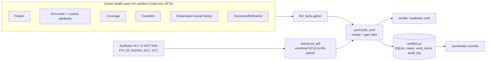

# wc-readiness

**Phase 0 of the RESET (workers' comp / return-to-work) project.** A command-line tool that builds a
**"WC readiness card"** for one patient visit. It reads Oracle Health's public FHIR sandbox, merges in
a (synthetic) HL7 v2 registration message, lists what's missing, and keeps a **coordinator worklist**
in SQLite.

> **Synthetic data only.** The demo patients, employers and claim numbers are invented. The live mode
> only talks to Oracle's *public test* sandbox, and only with read-only `GET` requests. Never point
> this at a real patient record or a work system. Not a medical device.

## Quick start

```bash
uv venv && uv pip install -e ".[dev]"     # or: python -m venv .venv && pip install -e ".[dev]"

wc-readiness --demo                       # offline: 2 invented patients, cards + worklist

# live, against Oracle Health's open R4 sandbox (no account needed; can take 20-120 s)
wc-readiness card --patient 12724066 --encounter 97954296 \
    --adt examples/messages/a04_sandbox_12724066.hl7

wc-readiness adt examples/messages/a04_wc_incomplete.hl7   # what WC fields are in this message?
wc-readiness worklist                                      # open items (from wc_worklist.db)
wc-readiness update 1 --status in_progress --owner "Knok"  # work an item
wc-readiness audit                                         # who changed what, when

pytest -q            # tests never touch the network
ruff check . && ruff format --check .
WC_LIVE=1 pytest -m live    # optional: one smoke test against the real sandbox
```

`card` exits with code `0` when the card is READY and `2` when it isn't, so a script can tell.
Add `--format json` to any card/worklist command for machine-readable output.

---

## The basics (read this first)

### What problem is this solving?

When someone is hurt at work, the hospital has to bill the employer's **workers' comp (WC)**
insurance instead of the patient's health plan. That only works if registration captured a handful
of things: the **employer**, the **date of injury**, the **WC carrier** (insurer or TPA) and the
**claim number**. In practice these are often missing, and one coordinator ends up chasing them
visit by visit. This tool checks a visit for those pieces and turns every gap into a to-do item.

### FHIR

**FHIR** (Fast Healthcare Interoperability Resources, R4 is the version used here) is the modern way
EHRs share data: a web API that returns JSON. Data comes in **resources**, each with a type and an
id, for example `Patient/12724066` or `Encounter/97954296`. You either **read** one resource
(`GET [base]/Patient/12724066`) or **search** for many (`GET [base]/Coverage?patient=12724066`), which
returns a `Bundle` (a list) that may be split over several pages.

The resources this tool reads:

| Resource | What it is | What we use from it |
|---|---|---|
| `Patient` | the person | name, birth date, MRNs (to match the HL7 message) |
| `Encounter` | one visit | class/type, start, **custom attributes** (see below) |
| `Coverage` | an insurance on file | `type` (is it WC?), `payor` (carrier), member id |
| `Condition` | a diagnosis or problem | injury diagnosis (ICD-10-CM S/T or V-Y codes) and onset |
| `Observation` (social history) | facts like occupation | occupation (LOINC 11341-5), employment status |
| `DocumentReference` | a note or document | is there a work status note yet? |

### SMART on FHIR

**SMART on FHIR** is the standard way to plug an app *into* the EHR: the clinician clicks the app in
PowerChart, the app gets an OAuth2 token limited to certain **scopes** (like `user/Coverage.read`)
and is told which patient and encounter are open. Phase 0 skips all of that on purpose: Oracle's
**open** sandbox needs no login. Phase 1 (Knok's own code Console registration) adds the real launch.

### HL7 v2 and its segments

Before FHIR, hospitals exchanged pipe-delimited **HL7 v2** messages, and registration events still
flow that way. An **ADT^A04** message means "a patient was registered" (typical for ED and
outpatient visits). A message is a list of **segments** (lines), each made of numbered **fields**
separated by `|`, and fields split further into **components** by `^`. "PV1-20" means "segment PV1,
field 20". The fields this tool reads (HL7 v2.5.1 numbering):

| Field | Name | Used for |
|---|---|---|
| PID-3, PID-5, PID-7 | Patient ID (MRN), name, birth date | matching the message to the FHIR patient |
| PV1-19, PV1-20 | Visit number, **Financial Class** | FC `WC` = "this visit is workers' comp" (site-defined values) |
| IN1-4 | Insurance company name | WC carrier / TPA |
| IN1-15 | Plan type | shown for reference |
| IN1-36 | Policy number | **claim number** by common convention (`UNKNOWN` counts as missing) |
| IN2-3 | Insured's employer name and ID | **employer** (1st choice) |
| GT1-51, GT1-16, IN1-11 | Guarantor employer org / name, group employer | **employer** fallbacks, in that order |
| ACC-1 | Accident date/time | **injury date** |
| ACC-2, ACC-5, ACC-8 | Accident code, **job related (Y/N)**, description | WC signal and conflicts |

Which of these your hospital's interface actually sends is local build: always check the site's ADT
spec. Example messages are in [`examples/messages/`](examples/messages/).

### Coverage type 95

`Coverage.type` says what kind of insurance a coverage is. Oracle codes it with the **Source of
Payment Typology** (system `urn:oid:2.16.840.1.113883.3.221.5`). In that code list **95 = Worker's
Compensation**, with children 951, 953, 954 and 959. The base FHIR value set has `WCBPOL` for the
same idea. This tool treats any of those as "WC coverage". Pip saw no type-95 coverage in the
sandbox, so whether your hospital's WC plans really come out as 95 is question #3 for IT.

### Encounter custom attributes

Oracle exposes site-defined registration fields on `Encounter` as extensions called **custom
attributes** (e.g. "Complete Reg?" in the sandbox). If a site captures the injury date or claim # in
one, this tool will find it by name (`claim`, `injury date`, `employer`...).

### The worklist (and why it's ours)

Oracle's FHIR API has **no `Task` resource** (Pip checked both CapabilityStatements), so there is
nowhere in the EHR to keep "chase claim # for this visit". The app keeps its own list in SQLite:

- each blocking/medium/low **gap** becomes a **work item** (`open`);
- the coordinator moves it to `in_progress`, `done` or `dismissed`, with an owner and a note;
- re-checking a visit **syncs** the list: fixed gaps close as `resolved`, gaps that come back are
  reopened, nothing is duplicated;
- every change goes into an **audit_log** table (who, what, when in UTC).

## How the pieces fit



| File | Job |
|---|---|
| `src/wc_readiness/fhir_client.py` | read-only HTTP client (retries, paging, `OperationOutcome` errors) and an offline `FixtureSource` |
| `src/wc_readiness/fhir_facts.py` | turns FHIR resources into facts; each failed request is recorded, not fatal |
| `src/wc_readiness/hl7v2.py` | HL7 v2 parser **vendored** from [hl7v2-to-fhir](https://github.com/Knok-exe/hl7v2-to-fhir) at commit `dc60de6` |
| `src/wc_readiness/adt.py` | pulls the WC fields out of an ADT message |
| `src/wc_readiness/card.py` | merges FHIR + ADT, decides where each value comes from, lists gaps |
| `src/wc_readiness/worklist.py` | SQLite worklist + audit log |
| `src/wc_readiness/render.py`, `cli.py` | text output and the `wc-readiness` command |
| `src/wc_readiness/demo/` | invented, Oracle-shaped FHIR fixture + two synthetic A04s for `--demo` |
| `scripts/make_demo_data.py` | regenerates the demo data and example messages |

### Where each essential value comes from

The first source with a value wins, and the card prints the source next to the value:

| Essential | 1st | 2nd | 3rd |
|---|---|---|---|
| Employer | ADT IN2-3 / GT1-51 / GT1-16 / IN1-11 | Encounter custom attribute | n/a |
| Injury date | ADT ACC-1 | Encounter custom attribute | injury `Condition.onsetDateTime` |
| Claim # | ADT IN1-36 | Encounter custom attribute | WC `Coverage` member id |
| Carrier | ADT IN1-4 | WC `Coverage.payor` | n/a |

ADT comes first because registration is where these get typed, and most aren't in Oracle's FHIR at
all. ADT fields are **only used if the message matches the FHIR patient** (by MRN, or name + birth
date); otherwise the card raises `ADT_PATIENT_MISMATCH` instead of mixing two people's data.

### The gap rules

| Code | Severity | Meaning |
|---|---|---|
| `WC_COVERAGE_MISSING` | high | no Coverage typed 95/951/953/954/959/WCBPOL (says so if PV1-20 claims WC) |
| `EMPLOYER_MISSING`, `INJURY_DATE_MISSING`, `CLAIM_NUMBER_MISSING`, `CARRIER_MISSING` | high | essential not found in any source |
| `ADT_PATIENT_MISMATCH` | high | the ADT is for someone else; its fields were ignored |
| `JOB_RELATED_NOT_FLAGGED` / `JOB_RELATED_CONFLICT` | medium | ACC-5 blank / ACC-5 = N on a WC visit |
| `INJURY_DATE_CONFLICT` | medium | sources disagree on the injury date |
| `INJURY_DX_MISSING` | medium | no ICD-10-CM injury code (S, T, V-Y) linked to the encounter |
| `OCCUPATION_MISSING` | low | no occupation in social history |
| `NO_ADT`, `ADT_WARNING`, `WORK_STATUS_NOTE_MISSING`, `FHIR_READ_FAILED:*` | info | context; not put on the worklist |

**READY** = no high gaps and every FHIR read worked. If a read failed (the sandbox sometimes times
out), the card says **UNKNOWN**, because "couldn't check" is not the same as "fine".

## Example output

From `wc-readiness --demo` (invented patients, no network), second card and the worklist:

```text
============================================================================================
WC READINESS CARD   NOT READY (3 blocking gap(s))
============================================================================================
Patient    Sampleperson, Casey  (FHIR Patient/demo-wc-1002, DOB 1995-02-03, MRN 700200)
Encounter  demo-enc-1002  emergency / Emergency / in-progress  started 2026-11-21
ADT        ADT^A04 WCDEMO0002, matched on MRN 700200
WC signals PV1-20 financial class = WC; injury diagnosis (Sprain of unspecified ligament of
   right ankle, initial encounter)

WC essentials
  Employer       MISSING
  Injury date    2026-11-20   [ACC-1]
  Claim #        MISSING
  Carrier / TPA  Sample Casualty TPA   [IN1-4]
...
Coordinator worklist
 ID  Status      Sev    Patient              Item                       Owner
-----------------------------------------------------------------------------
  1  open        high   Sampleperson, Casey  CLAIM_NUMBER_MISSING       -
  2  open        high   Sampleperson, Casey  EMPLOYER_MISSING           -
  3  open        high   Sampleperson, Casey  WC_COVERAGE_MISSING        -
  4  open        medium Sampleperson, Casey  INJURY_DATE_CONFLICT       -
  5  open        medium Sampleperson, Casey  JOB_RELATED_NOT_FLAGGED    -
  6  open        low    Sampleperson, Casey  OCCUPATION_MISSING         -
```

Live run against the sandbox (patient 12724066, encounter 97954296, merged with the synthetic
`a04_sandbox_12724066.hl7`) on 2026-11-24 matched the ADT on MRN 6000031 and came back NOT READY:
`WC_COVERAGE_MISSING` (the sandbox patient only has Medicare/Medicaid/private/public coverages),
`INJURY_DX_MISSING` and `OCCUPATION_MISSING` (the sandbox's occupation is "Unknown").

## Getting to go-live (CommunityWorks)

This Phase 0 build needs no account and touches no hospital system. Getting a real app into
PowerChart/FirstNet is a different matter:

- **Knok's hospital is on Oracle Health CommunityWorks** (a shared-domain hosting model). Oracle's
  docs say self-service app provisioning **does not apply** to CommunityWorks and other shared-domain
  customers, so go-live runs through **Oracle Service Requests (SRs)** that the *hospital* logs (to
  "Cerner Ignite APIs for Millennium"): provisioning the app and client id to the tenant (non-prod
  first), approving the **scopes**, mapping codable concepts (custom attribute codes may need the
  "DataWorks_FHIR_PopHlth" mapping), a PECA form if required, Citrix trusted sites, and PowerChart /
  FirstNet setup with position-based access. Expect the Oracle rep to be involved.
- Before that: Phase 1 (Knok's own CernerCare + code Console registration, secure sandbox, EHR
  launch, writing a work status note as a `DocumentReference`), then Phase 2 with hospital IT (an
  outbound ADT feed filtered to the WC financial class, the site's ADT spec, hosting and security
  review). See Pip's `RESEARCH.md` section 5.

### The lower-code alternative: CCL report or MPage

The whole point of the worklist is "show me every WC visit with something missing". FHIR can't
search by coverage type or financial class, but **Discern Explorer (CCL)** queries Millennium's
database directly. A CCL report (or an **MPage**, the HTML component framework inside PowerChart)
could list today's WC-financial-class encounters with blank employer/injury date/claim fields,
built and owned by the hospital's own Cerner analysts, with **no external app, no SMART
registration and no SRs**. Pair it with making the WC fields *required* in the registration
conversation and much of the problem may go away. The trade-offs: it needs CCL access and analyst
time, it lives inside one hospital's build, and it doesn't give you a portable app or the audit
trail this tool keeps. Pip marks this alternative as INFERRED (not verified at Knok's site), so it's
worth asking IT about before going further than Phase 1.

## Limitations

- **Synthetic, read-only, Phase 0.** No writes, no SMART launch, no authentication.
- **One patient at a time.** Oracle FHIR has no "all WC visits" search; the real worklist needs an
  ADT feed (Phase 2) or a CCL extract. Here the A04 file is passed by hand.
- **WC detection is heuristic.** Coverage type codes are reliable *if* the site maps WC plans to SOP
  95 (unverified). Financial class values are site-defined: pass `--wc-class` for yours. Injury
  diagnosis = ICD-10-CM chapters 19/20 codes linked to the encounter (T78 allergies count too).
- **Claim # in IN1-36** is a convention, not a standard. Some sites use IN1-49 or a custom attribute.
- **Custom attributes are matched by name**, which is fragile; production should use attribute ids.
- **Latest encounter** (when `--encounter` is omitted) is picked from the first 20 results only.
- **The sandbox is shared and slow.** Its data changes; Condition searches return the patient's whole
  problem list (1,700+ items) and sometimes time out. The tool filters client-side and reports
  failed reads instead of crashing.
- **Not done yet:** HL7 table validation, A08/A03/A11 handling, multiple IN1 repetitions, PHI-safe
  logging, the coordinator UI (Phase 0 is CLI-only).

## Reuse of hl7v2-to-fhir

`src/wc_readiness/hl7v2.py` is a verbatim copy of `src/hl7_fhir/parser.py` from
[Knok-exe/hl7v2-to-fhir](https://github.com/Knok-exe/hl7v2-to-fhir) at commit
`dc60de6840d531607af02002bca97abe495889b1` (MIT, same author). The only change is that
`ParseError` is defined locally. It's copied rather than installed because that repo has no release
tag yet, and depending on an unpinned `git+...@main` would let upstream changes break this project
without warning. Once hl7v2-to-fhir tags a release, swap the file for a pinned dependency.

## License

MIT, see [LICENSE](LICENSE).
